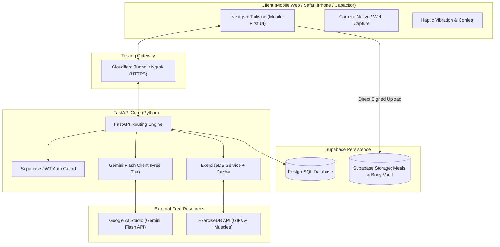

# 📋 FORMA: MASTER IMPLEMENTATION PLAN (V1 - FRONTEND-FIRST FOCUS)
### *Intelligence Behind Your Transformation*

> **Phiên bản:** v1.1.0 (Frontend-First Strategy & Strict Minimal Green Palette)  
> **Trọng tâm hiện tại:** Thiết kế UI/UX và hoàn thiện toàn bộ logic Frontend Client trước; Server & Backend API sẽ phát triển ở giai đoạn sau.  
> **Quy chuẩn màu sắc:** Tối giản 3-4 màu cốt lõi, màu chủ đạo Xanh lá cây (Fitness Green).

---

## 1. NGUYÊN TẮC THIẾT KẾ & BẢNG MÀU TỐI GIẢN (STRICT 3-4 COLORS)

Nhằm tối ưu sự tập trung của người dùng và tạo phong cách công nghệ thể thao đẳng cấp, hệ thống áp dụng bảng màu tối giản không quá 4 màu:

| Vai trò màu | Mã màu HEX | Ứng dụng trong Giao diện |
| :--- | :--- | :--- |
| **1. Nền tối sâu (Deep Dark)** | `#090D0B` | Nền toàn bộ ứng dụng, tạo cảm giác sang trọng, chống mỏi mắt. |
| **2. Bề mặt thẻ (Surface/Card)** | `#121814` | Các card bài tập, card macro, modal với viền tinh tế `rgba(34, 197, 94, 0.12)`. |
| **3. Màu chủ đạo (Primary Green)** | `#22C55E` / `#16A34A` | Màu xanh lá cây tràn đầy năng lượng: Thanh tiến độ, nút hành động chính, viền active, chỉ số hoàn thành. |
| **4. Chữ & Phụ trợ (Typography)** | `#F9FAFB` & `#9CA3AF` | Trắng sáng cho tiêu đề số liệu; Xám bạc cho văn bản phụ và đơn vị. |

---

## 2. CẤU TRÚC ĐIỀU HƯỚNG CHÍNH (4 TABS + CAMERA BUTTON)

1. **Tab 1: Hôm nay (Today Progress Dashboard)**
   - Vòng tiến độ (Progress Wheel/Track) tổng quan.
   - Thể hiện đầy đủ trạng thái **[Hiện tại / Tổng]** cho:
     - **Tập luyện:** Ngày tập trong tuần (Ví dụ: 3/4 buổi), Số bài đã tập / Tổng số bài (4/6 bài), Số Sets hoàn thành.
     - **Macro:** 4 chỉ số bắt buộc: Kcal (Hiện tại / Mục tiêu), Protein (g), Carb (g), Fat (g).
2. **Tab 2: Tập luyện (Workout)**
   - Danh sách thẻ bài tập hôm nay: Ảnh GIF động kỹ thuật chuẩn, Sets, Reps, Nhóm cơ tác động, Tips tập luyện.
   - Nút tương tác Tap/Swipe hoàn thành từng set.
3. **Nút Camera ở giữa (Quick Snap Placeholder)**
   - Mở modal chụp ảnh món ăn hoặc check-in vóc dáng nhanh.
4. **Tab 3: Macro (Dinh dưỡng & Bữa ăn)**
   - Danh sách thẻ các bữa đã nạp trong ngày (Bữa sáng, Trưa, Tối, Snack) kèm ảnh món ăn và thông số calo/macro.
5. **Tab 4: Hồ sơ (Profile)**
   - Thông tin cá nhân cơ bản (Tuổi, Chiều cao, Cân nặng, Mục tiêu).
   - Thanh tiến độ hồ sơ thể lực (60%) kèm Checklist nhắc nhở nhẹ nhàng. Cài đặt tài khoản.

---

## 3. LỘ TRÌNH ĐIỀU CHỈNH: FRONTEND-FIRST ROADMAP

- **Pha 1 (Hiện tại): Hoàn thiện UI/UX & Client Logic:**
  - Triển khai toàn diện 4 Tabs với bảng màu Xanh lá cây tối giản.
  - Xây dựng đầy đủ trạng thái dữ liệu mẫu sống động (Realistic Client Mock State), tương tác Set completion, Macro accumulation, Camera upload placeholder.
  - Tối ưu cảm ứng Safari iPhone (Dynamic viewport, safe-area-insets, không mở bàn phím ảo).
- **Pha 2: Gamification Tamagotchi Avatar Engine (Frontend Prototype):**
  - Tích hợp linh vật thể lực (FORMA Avatar): Hệ thống Level, XP, Năng lượng, Trạng thái cảm xúc (Sung sức, Mệt mỏi, Tăng cấp).
- **Pha 3: Server & Backend API Integration (Sau khi chốt UI/UX):**
  - Kết nối Supabase Auth, PostgreSQL Database, Storage Bucket.
  - Tích hợp FastAPI + Google Gemini Flash API cho bóc tách ảnh thức ăn thực tế và đổi bài tập tự động.
- **Pha 4: Đóng gói Native App (Capacitor by Ionic):**
  - Chuyển giao lên App Store & Google Play.

---

## 4. BỘ NÃO GAMIFICATION: "TAMAGOTCHI VIRTUAL FITNESS AVATAR"

Một bước chuyển mình đột phá biến quá trình tập luyện và dinh dưỡng khô khan thành một trò chơi nuôi thú ảo / phát triển nhân vật (Virtual Avatar Companion).

### 4.1. Cơ Chế Vòng Lặp Tâm Lý (Psychological Tamagotchi Loop)
Người dùng không chỉ tập cho bản thân mà còn chịu trách nhiệm nuôi nấng và tiến hóa **Nhân vật ảo (FORMA Beast / Cyber Avatar)**:
- **Tập luyện mỗi Set / Bài tập:** Cung cấp **XP (Kinh nghiệm)** và **STR (Sức mạnh)** ➔ Nhân vật vạm vỡ hơn, lên cấp (Level Up) và mở khóa trang bị thể thao (Găng tay, Đai lưng, Áo đấu).
- **Ăn uống & Nạp Macro chuẩn:** Tương đương việc "Cho nhân vật ăn" ➔ Hồi phục **Stamina (Thể lực)** và **HP**. Đạt chỉ tiêu Protein kích hoạt trạng thái *"Hồi phục siêu tốc (Hyper Recovery)"*.
- **Giữ Streak liên tục:** Nhân vật tiến hóa qua các hình thái (Evolution Stages).
- **Khi lười tập / Bỏ bữa:** Nhân vật không chết (tránh gây ức chế bỏ app), mà chuyển sang trạng thái ngái ngủ, uể oải ➔ Tạo sự thôi thúc tình cảm (Emotional Attachment) khiến người dùng xỏ giày đi tập để "đánh thức" nhân vật.

### 4.2. Hệ Thống Chỉ Số & Cấp Độ (Avatar Stat System)

| Chỉ số nhân vật | Hành động thực tế của User | Tác động trong App |
| :--- | :--- | :--- |
| **Level & XP** | Hoàn thành Set tập, hoàn thành buổi tập | Tăng cấp độ (Lv.1 ➔ Lv.50), mở khóa huy hiệu, danh hiệu và phụ kiện độc quyền. |
| **Thể lực (Energy/STA)** | Ăn đúng calo mục tiêu | Giữ nhân vật luôn trong trạng thái tràn đầy sinh lực (100% Energetic). |
| **Cơ bắp (Muscle Tone)** | Đạt đủ chỉ tiêu Protein | Ngoại hình nhân vật sắc nét hơn, phát sáng hào quang xanh lá (Emerald Glow). |
| **Chuỗi Tiến Hóa (Evolution)** | Duy trì Streak 7 - 30 - 90 ngày | Tiến hóa hình thái: Mầm Non (Novice) ➔ Chiến Binh Sắt (Iron Warrior) ➔ Thần Thể Titan (Cyber Titan). |

### 4.3. Đề Xuất Giải Pháp Kỹ Thuật (Tech Strategy cho Avatar)
- **Giai đoạn 1 (Nhẹ & Mượt mà):** Sử dụng **SVG động / Lottie Animations / Rive** để render nhân vật 2D chất lượng cao, phản ứng tức thì theo từng nút bấm mà không tốn dung lượng hay gây hao pin iPhone.
- **Giai đoạn 2 (3D Tương Tác):** Nâng cấp lên WebGL / Three.js / Spline 3D khi chuyển sang Native App bằng Capacitor.



---

## 3. CẤU TRÚC DỮ LIỆU (DATABASE SCHEMA SUPABASE)

### 3.1 Bảng dữ liệu quan hệ (PostgreSQL)

1. **`profiles`**:
   - `id` (UUID, PK, matches `auth.users.id`)
   - `height_cm`, `weight_kg`, `target_weight_kg`, `bodyfat_est` (Float)
   - `activity_level` (Sedentary, Light, Moderate, Very Active)
   - `primary_goal` (Cut, Bulk, Recomp, Strength)
   - `experience_level` (Beginner, Intermediate, Advanced)
   - `dietary_preferences` (JSONB - Dị ứng, ăn chay, số bữa/ngày)
   - `created_at` (Timestamp)

2. **`exercises_cache`** *(Tối ưu hóa từ ExerciseDB)*:
   - `id` (String, PK - ExerciseDB ID)
   - `name` (String - Tên bài tập)
   - `target_muscle` (String - Nhóm cơ chính)
   - `secondary_muscles` (Array[String] - Nhóm cơ phụ)
   - `equipment` (String - Tạ đơn, đòn, máy, bodyweight)
   - `gif_url` (String - Link hình động kỹ thuật)
   - `instructions` (Array[String] - Hướng dẫn chi tiết)
   - `approx_cal_per_set` (Float)

3. **`workout_plans` & `workout_sessions`**:
   - Lưu lộ trình do Gemini Flash sinh ra theo tuần/ngày.
   - Liên kết danh sách bài tập từ `exercises_cache`.

4. **`daily_nutrition_logs` & `meal_items`**:
   - Theo dõi Calo, Protein, Carbs, Fat theo ngày.
   - Lưu thông tin món ăn từ ảnh bóc tách qua Gemini Flash Vision.

5. **`body_checkins`**:
   - `id`, `user_id`
   - `photo_front_path`, `photo_side_path` (Private Storage)
   - `scale_weight_kg`
   - `ai_analysis_text` (Gemini Flash so sánh tỷ lệ mỡ/cơ)
   - `created_at`

---

## 4. CHI TIẾT CÁC GIAI ĐOẠN TRIỂN KHAI (STAGES)

### GIAI ĐOẠN 1: KHỞI TẠO NỀN TẢNG & SUPABASE DATA LAYER
*Mục tiêu: Hoàn thiện môi trường phát triển, schema DB và tích hợp các API miễn phí.*

- [ ] **1.1. Supabase Initialization:**
  - Khởi tạo project Supabase miễn phí.
  - Chạy migration tạo các bảng (`profiles`, `exercises_cache`, `workout_plans`, `daily_nutrition_logs`, `body_checkins`).
  - Thiết lập 2 Storage Buckets: `meal-photos` (private, signed url) và `body-vault` (strict RLS).
- [ ] **1.2. FastAPI Scaffolding:**
  - Khởi tạo repo backend với cấu trúc Clean Architecture.
  - Tích hợp `google-genai` SDK với API Key từ Google AI Studio (Gemini Flash).
  - Tích hợp client kết nối ExerciseDB qua RapidAPI (kèm logic lưu cache bài tập vào Postgres để không gọi lặp API).
  - Viết middleware xác thực JWT từ Supabase.

---

### GIAI ĐOẠN 2: ONBOARDING TỐI ƯU HÓA (LOW-FRICTION & GAMIFIED) & BỘ NÃO GEMINI FLASH
*Mục tiêu: Đạt tỷ lệ hoàn thành (Conversion Rate) cao nhất, giảm thiểu gõ phím, sinh giáo án tức thì và hối thúc hoàn thiện hồ sơ qua Checklist thông minh.*

#### 2.1. Phân định dữ liệu Onboarding:
- **Nhóm 1: Bắt buộc (Tối thiểu - Chỉ 2 trang, max 5 ô/trang):**
  - *Trang 1 (Vóc dáng cơ bản):* Giới tính (Nút bấm Nam/Nữ), Tuổi (Thanh cuộn/Scroll picker), Chiều cao & Cân nặng hiện tại (Wheel Picker dạng trượt ngang/dọc, không cần gõ bàn phím).
  - *Trang 2 (Mục tiêu & Lịch tập):* Mục tiêu chính (Tap chọn Card: Tăng cơ | Giảm mỡ | Recomp | Sức bền), Số buổi tập/tuần (Nút bấm chọn nhanh: 2, 3, 4, 5, 6 buổi).
  - *Đầu ra:* Đủ 100% dữ liệu để công thức Mifflin-St Jeor / Katch-McArdle tính BMR, TDEE, phân chia Macro và Gemini Flash sinh lộ trình tập tức thì.
- **Nhóm 2: Nâng cao (Optional - Nhập sau qua Profile Nudge):**
  - Tỷ lệ Body Fat %, Mức độ vận động (PAL), Địa điểm tập (Gym vs Home), Tiền sử chấn thương (để AI né khớp đau), Chế độ ăn kiêng / Dị ứng.

#### 2.2. Luồng trải nghiệm (User Journey Flow):
```
[1. Đăng nhập / Tạo tài khoản] (Google Auth / Email qua Supabase)
       │
       ▼
[2. Onboarding Bắt buộc] ──► (2 bước tinh gọn, Zero-Keyboard, Wheel Picker & Card Tap)
       │
       ▼
[3. AI Loading Animation] ──► (Gemini Flash sinh Lịch tập & Macro trong ~1.5s)
       │
       ▼
[4. Vào Dashboard & Profile Nudge] ──► (Tracker "Hồ sơ: 60%" + Checklist nhắc nhở nhẹ nhàng)
```

#### 2.3. Quy chuẩn thiết kế UI/UX Onboarding (Zero-Keyboard Design):
- **Zero-Keyboard:** 100% tương tác bằng ngón tay cái qua Wheel Picker, Toggle Chip và Selectable Card. Không bật bàn phím ảo iOS gây che khuất màn hình.
- **Gamified Progress Bar:** Thanh tiến độ mượt mà từ 0% ➔ 50% ➔ 100% kết hợp Framer Motion.
- **Accomplishment Nudge:** Hiệu ứng pháo hoa Confetti nhỏ và thông báo kích hoạt thành công: *"Xong! AI đã sẵn sàng biến đổi vóc dáng của bạn."*
- **Profile Nudge & Checklist:**
  - Hiển thị thanh tiến độ hồ sơ thể lực (VD: *60% hoàn thành*).
  - Checklist thưởng huy hiệu: `[ ] Thêm thông tin chấn thương để AI bảo vệ khớp`, `[ ] Cập nhật Body Fat% để tính chuẩn xác hơn`.
  - **Quy tắc vàng:** Tuyệt đối không hỏi lại thông tin đã nhập từ lần đăng nhập thứ 2 trở đi.

#### 2.4. Gemini Flash Prompt Engineering & Structured JSON:
- Viết System Prompt chuyên gia Thể hình & Dinh dưỡng.
- Định nghĩa `Pydantic Schema` nghiêm ngặt cho Output (`response_mime_type="application/json"`).
- Gemini Flash trả về phân chia Macro (Calo, P/C/F) và lịch tập chi tiết map theo ExerciseDB IDs.

---

### GIAI ĐOẠN 3: GIAO DIỆN TẬP LUYỆN TƯƠNG TÁC (INTERACTIVE WORKOUT SUITE)
*Mục tiêu: Đem lại trải nghiệm tập luyện trực quan tại phòng gym, hỗ trợ đổi bài tập tức thì.*

- [ ] **3.1. Visual Exercise Card:**
  - Hiển thị bài tập với GIF chuyển động mượt từ ExerciseDB cache.
  - Hiển thị số Sets, Reps, khối lượng tạ đề xuất và calo ước tính.
- [ ] **3.2. Interactive Execution (Swipe/Tap to Done):**
  - Cơ chế Check / Swipe hoàn thành từng set với thanh tiến độ buổi tập (Workout Progress Bar) cập nhật tức thì.
  - Đồng hồ đếm ngược thời gian nghỉ (Rest Timer) nổi kèm âm thanh nhẹ khi hết giờ.
- [ ] **3.3. Real-Time AI Feedback Loop (Hoán đổi bài tập thông minh):**
  - Nút bấm nhanh khi gặp sự cố: *"Đau khớp/chấn thương"*, *"Máy tạ đang bận"*, *"Hết tạ phù hợp"*.
  - Gửi request đến FastAPI ➔ Gemini Flash tìm kiếm bài tập thay thế từ `exercises_cache` cùng nhóm cơ mà không gây áp lực lên khớp bị đau trong vòng **< 1.5 giây**.

---

### GIAI ĐOẠN 4: SMART VISION NUTRITION TRACKER & GAMIFICATION
*Mục tiêu: Quẹt ảnh món ăn để track calo trong 1 chạm, tạo dopamine chinh phục.*

- [ ] **4.1. Camera Upload & Nén ảnh Client-side:**
  - Sử dụng HTML5 Camera capture trên Safari / Capacitor Camera.
  - Tự động nén ảnh tại máy người dùng xuống dưới 300KB (giảm độ trễ truyền dữ liệu mạng).
- [ ] **4.2. Gemini Flash Multimodal Vision Parsing:**
  - Gửi ảnh qua Gemini Flash Vision API với prompt bóc tách ẩm thực (đặc biệt tối ưu nhận diện món ăn Việt Nam như Phở, Cơm tấm, Bún bò, Ức gà, Trứng,...).
  - Trả về danh sách nguyên liệu, định lượng gram ước tính và các chỉ số Macro (Calo, P, C, F) kèm độ tin cậy.
- [ ] **4.3. Swipe-to-Log & Dopamine Loop:**
  - Hiển thị popup kết quả cho người dùng tinh chỉnh nhanh nếu muốn ➔ Vuốt phải để xác nhận trừ vào tổng ngày.
  - Visual Progress Rings cập nhật thời gian thực.
  - Hiệu ứng pháo hoa Confetti + Haptic vibration khi đạt chỉ tiêu Protein hoặc chuỗi streak ngày.

---

### GIAI ĐOẠN 5: AI BODY PROGRESS TRACKER & ANTHROPOMETRICS
*Mục tiêu: Đo lường sự thay đổi thể hình thực tế qua thị giác máy tính.*

- [ ] **5.1. Private Body Vault:**
  - Giao diện chụp ảnh định kỳ (Mặt trước / Mặt nghiêng).
  - Lưu ảnh có gắn nhãn ngày chụp (timestamp) vào Supabase Storage bảo mật riêng tư.
- [ ] **5.2. Gemini Flash Vision Body Composition Compare:**
  - Đưa 2 ảnh mốc thời gian (ví dụ: Tuần 1 vs Tuần 4) vào Gemini Flash Vision.
  - Prompt yêu cầu đánh giá độ nét cơ bắp (vascularity, vai, ngực, eo) và ước tính sự thuyên giảm mỡ dưới da.
  - Kết hợp với biểu đồ cân nặng để đưa ra nhận xét khoa học: *"Đang giảm mỡ giữ cơ tốt"* hoặc *"Cần tăng thêm 15g protein"*.

---

### GIAI ĐOẠN 6: KIỂM THỬ THỰC TẾ TRÊN IPHONE THẬT (CLOUDFLARE TUNNEL)
*Mục tiêu: Tinh chỉnh toàn bộ cảm giác cầm nắm và tương tác trên Safari iOS trước khi đóng gói.*

- [ ] **6.1. Thiết lập Tunnel:**
  - Mở cổng `cloudflared tunnel --url http://localhost:3000` kết nối trực tiếp đến iPhone vật lý.
- [ ] **6.2. Kiểm thử thực tế trên iPhone:**
  - Kiểm tra Safe Area Insets (tai thỏ / Dynamic Island) không bị che nút.
  - Kiểm tra độ nhạy cử chỉ vuốt chạm (Swipe to done).
  - Kiểm tra tốc độ chụp và gửi ảnh camera qua mạng 4G/5G.
  - Đảm bảo âm thanh đếm giờ nghỉ hoạt động được trên chế độ im lặng/Safari nền.

---

### GIAI ĐOẠN 7: ĐÓNG GÓI CAPACITOR SANG NATIVE MOBILE APP
*Mục tiêu: Chuyển đổi mã nguồn Next.js thành ứng dụng cài đặt trực tiếp trên iOS và Android.*

- [ ] **7.1. Cấu hình Capacitor:**
  - Tích hợp `@capacitor/core`, `@capacitor/cli`, `@capacitor/camera`, `@capacitor/haptics`, `@capacitor/status-bar`.
  - Cấu hình file `capacitor.config.ts`.
- [ ] **7.2. Đồng bộ & Build Native:**
  - `npx cap add ios` & `npx cap add android`.
  - Thiết lập quyền `NSCameraUsageDescription` và `NSPhotoLibraryUsageDescription` trong iOS `Info.plist`.
  - Kiểm tra Native Haptics rung chuẩn theo từng hành động người dùng.

---

## 5. DỰ TOÁN CHI PHÍ & HẠN MỨC FREE TIER

| Dịch vụ | Gói sử dụng | Giới hạn miễn phí | Chiến lược không vượt ngưỡng |
| :--- | :--- | :--- | :--- |
| **Google AI Studio (Gemini Flash)** | Free Tier API Key | 15 Requests/phút (RPM), 1 triệu Tokens/phút (TPM), 1,500 Requests/ngày | Sử dụng Gemini Flash tốc độ cao; cache kết quả lộ trình tập theo tuần, chỉ gọi API khi bóc tách món ăn hoặc đổi bài tập. |
| **ExerciseDB** | Free RapidAPI / Cache | ~500 calls/tháng (Free) | Tải và lưu cache toàn bộ thông tin 1,300+ bài tập vào Supabase Postgres một lần duy nhất. Ứng dụng chỉ query từ database nội bộ ($0 call API). |
| **Supabase** | Free Tier | 500MB Database, 1GB File Storage, 50,000 MAU | Tự động resize/nén ảnh xuống < 300KB trước khi upload lên Storage. Đủ cho hàng nghìn lần check-in. |
| **Cloudflare Tunnel** | Free | Không giới hạn băng thông | Dùng test localhost trên iPhone hoàn toàn miễn phí. |
| **Vercel / Local Host** | Free Hobby | Đủ cho môi trường Dev & Test | Hosting Next.js miễn phí. |

---

## 6. TIÊU CHÍ NGHIỆM THU ĐỂ VERIFY (VERIFICATION CHECKLIST)

Sau khi bạn kiểm duyệt kế hoạch này, hệ thống sẽ tiến hành các bước theo tiêu chí nghiệm thu sau:

- [ ] **Tiêu chí 1:** Kiến trúc bảo đảm 100% không phát sinh chi phí API trong giai đoạn phát triển và thử nghiệm.
- [ ] **Tiêu chí 2:** Tốc độ phản hồi của AI bóc tách món ăn và hoán đổi bài tập đạt chuẩn $\le 2$ giây nhờ Gemini Flash.
- [ ] **Tiêu chí 3:** Trải nghiệm trên Safari iPhone mượt mà, hỗ trợ camera chụp món ăn trực tiếp không giật lag.
- [ ] **Tiêu chí 4:** Codebase thiết kế sẵn sàng cho việc đóng gói lên App Store / Google Play qua Capacitor mà không phải viết lại logic.

---

> 📌 **Ghi chú:** Bản kế hoạch v1 đã được lưu trữ vĩnh viễn tại file:  
> `d:\Future Career\FORMA - Intelligence Behind Your Transformation\Master_Plan_v1.md`  
> Bạn có thể mở đọc, rà soát và phản hồi bất kỳ điều chỉnh nào trước khi chúng ta chính thức bắt tay vào lập trình.

